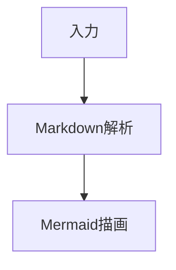

# TextTube — YouTube 動画を「読む」体験へ

YouTube の長尺動画の内容を効率的に把握するための、要約・スクリプト閲覧サイトです。動画の文字データを抽出し、整理されたテキストとして閲覧することで、**「必要な情報だけを短時間で取り出す」**タイパ（タイムパフォーマンス）を重視した視聴体験を提供します。

本プロジェクトは、[everything-claude-code](https://github.com/affaan-m/everything-claude-code) の設計思想をベースに、開発者自身が Antigravity 環境での利用に最適化させた [Antigravity Starter Kit](https://github.com/hiraku00/antigravity-starter-kit) を基盤として構築されています。AI エージェントを介した設計・実装プロセスを活用し、一貫した品質での開発を実現しています。

## 解決する課題

- **時間の節約**: 長尺動画を短時間で読める要約テキストに変換し、内容把握を高速化します。
- **情報の再利用性**: 動画内容がテキストとして整理されるため、検索やナレッジベースへの蓄積が容易になります。
- **外部ツールとの連携**: 文字取得や要約生成は既存の LLM サービスやブラウザ拡張機能で行い、そのアウトプットを「価値ある資産」として管理・閲覧するための専用 UI を提供します。

## 主な特徴

- **YouTube クローン UI**: ダークモードを基調とした、直感的で馴染みのあるナビゲーション。
- **快適な閲覧体験 (Watch Page)**: 固定ヘッダー（Sticky Header）により、スクロール中も動画タイトルとメタデータを常に表示。目次も追従し長文記事の閲覧をサポート。ワンクリックで元動画へアクセス可能。
- **自動読了目安計算**: テキストのボリュームから「読むのにかかる時間」を算出し、視聴（読書）の負荷を可視化。
- **コンテンツ・スタジオ (Improved)**: 
    - **動画一覧の高度化**: タイトル・チャンネル名による全文検索機能、閲覧数、再生時間、推定読了時間の表示。柔軟なソート機能（最新順・更新日順・人気順）。
    - **入力支援フォーム**: チャンネル名の自動補完、新規チャンネル警告、HH:MM:SS分割入力、高度な設定アコーディオン。
    - 「迷わない、間違えない」ためのプレミアムな管理体験を提供。
- **モダンなデータ基盤**: Supabase (PostgreSQL) による高速かつセキュアなデータ管理。

## 技術スタック

- **Frontend**: Next.js 15 (App Router / Turbopack)
- **Styling**: Tailwind CSS v4
- **Icons**: Lucide React
- **Database**: Supabase (PostgreSQL)
- **Infrastructure**: Vercel

## 自動運用と CI/CD (Zero Config)

本プロジェクトは Vercel と GitHub の連携により、開発者の手間を最小限に抑えた以下の運用フローが適用されます。

- **Production 自動デプロイ**: `main` ブランチへの push をトリガーにビルドが実行され、成功時のみ本番環境へデプロイされます。
- **Preview デプロイ**: プルリクエスト（PR）ごとに、本番反映前の動作確認ができる独立したプレビューURLが自動生成されます。
- **ビルド時検証**: TypeScript の型チェックがビルドプロセスに含まれており、安全性が担保された状態でのみリリースが行われます。

### Supabase Free プランの自動停止回避

Supabase の Free プランでは、一定期間データベースへの利用が少ないプロジェクトが自動的に一時停止されることがあります。このプロジェクトでは、それを避けるために GitHub Actions から Supabase REST API へ定期的に軽い読み取りリクエストを送っています。

対象のワークフローは以下です。

```text
.github/workflows/keep-supabase-active.yml
```

#### 何をしているか

このワークフローは毎日 1 回、GitHub Actions 上で `curl` を実行し、Supabase の `videos` テーブルから `id` を最大 1 件だけ読み取ります。

```http
GET /rest/v1/videos?select=id&limit=1
```

これは読み取り専用のリクエストです。データの作成・更新・削除は行いません。`videos` テーブルにデータが 0 件でも、Supabase と RLS 設定が正常であれば空配列が返り、ワークフローは成功します。

実行スケジュールは GitHub Actions の cron で管理しています。

```yaml
schedule:
  - cron: "0 0 * * *"
```

GitHub Actions の cron は UTC 基準なので、`0 0 * * *` は日本時間の毎日 09:00 に相当します。

#### なぜやっているか

Supabase から「過去 7 日間のアクティビティが不足しているため、プロジェクトが一時停止対象になる可能性がある」という通知が来たためです。アプリを毎日手動で開く代わりに、GitHub Actions で最低限のデータベースアクセスを自動化しています。

ただし、Supabase は「sufficient activity」の厳密な判定条件を公開していません。そのため、この設定は実用上の自動停止回避策ですが、将来の Supabase 側の仕様変更まで保証するものではありません。

#### 使っている GitHub Secrets

ワークフローでは以下の GitHub Actions Secrets を参照します。

```text
NEXT_PUBLIC_SUPABASE_URL
NEXT_PUBLIC_SUPABASE_PUBLISHABLE_KEY
```

Next.js アプリ本体でも同じ名前の環境変数を使っているため、GitHub Actions 側も同じ名前に揃えています。`NEXT_PUBLIC_` という接頭辞は Next.js のブラウザ公開用環境変数を意味しますが、GitHub Actions では単なる環境変数名として扱われます。

`service_role` キーや `NEXT_SUPABASE_SECRET_KEY` は使いません。このワークフローは公開用の publishable key で実行できる読み取り処理だけを行うため、強い権限のキーを GitHub Actions に渡さない方が安全です。

#### どう設定したか

ローカルの `.env.local` に設定されていた以下の値を使って、GitHub CLI で repository secret として登録しました。

```text
NEXT_PUBLIC_SUPABASE_URL
NEXT_PUBLIC_SUPABASE_PUBLISHABLE_KEY
```

登録に使った操作は概ね以下です。

```bash
awk '/^NEXT_PUBLIC_SUPABASE_(URL|PUBLISHABLE_KEY)=/' .env.local \
  | gh secret set -f - --repo hiraku00/text-tube
```

登録後、以下のように secret 名が存在することを確認しました。

```bash
gh secret list --repo hiraku00/text-tube
```

期待される表示名は以下です。値そのものは GitHub 上でも表示されません。

```text
NEXT_PUBLIC_SUPABASE_PUBLISHABLE_KEY
NEXT_PUBLIC_SUPABASE_URL
```

#### 動作確認方法

手動で実行する場合は GitHub の Actions 画面から `Keep Supabase Active` を選び、`Run workflow` を押します。

GitHub CLI から実行する場合は以下です。

```bash
gh workflow run keep-supabase-active.yml --repo hiraku00/text-tube --ref main
```

実行結果の確認は以下です。

```bash
gh run list --workflow keep-supabase-active.yml --repo hiraku00/text-tube
```

正常な場合、ログには以下のような内容が表示されます。

```text
Supabase returned HTTP 200
Supabase project responded successfully.
```

失敗した場合は、まず GitHub Secrets の名前がワークフロー内の参照名と一致しているか、Supabase の publishable key が有効か、`videos` テーブルの読み取りが publishable key で許可されているかを確認してください。

## コンテンツ作成ガイド (TOC 生成規則)

本サイトの Markdown レンダラーは、見出し（`#`, `##`, `###`）からアンカーリンク用の ID を自動生成します。また、本文内の内部リンク（`#` で始まるリンク）も自動的に同じ規則で正規化されるため、LLM サービスで複雑な変換ルールを意識する必要はありません。

Mermaid のコードブロックにも対応しています。フローチャートなどを表示する場合は、コードブロックの言語に `mermaid` を指定してください。

````markdown

````

### LLM へのプロンプト例

要約を作成する際は、以下のようなシンプルな指示で目次を機能させることができます。

> 各セクションへの目次リンクを作成してください。
> - リンク先は `#見出しテキスト` としてください
> - 例: `## 1. 導入：AIの進化` へのリンクは `[導入](#1. 導入：AIの進化)`
> - システム側で自動的に小文字化や記号除去を行うため、見出しの文言をそのままリンク先に指定して問題ありません。

---

## セットアップ手順

1. **初期設定**: `npm install`
2. **環境変数**: `.env.local.example` を参考に `.env.local` を作成し接続情報を設定。
3. **DB構築**: `supabase/schema.sql` を Supabase の SQL エディタで実行（マイグレーション不要の一発構築）。
4. **起動**: `npm run dev`

## ライセンス

MIT License
